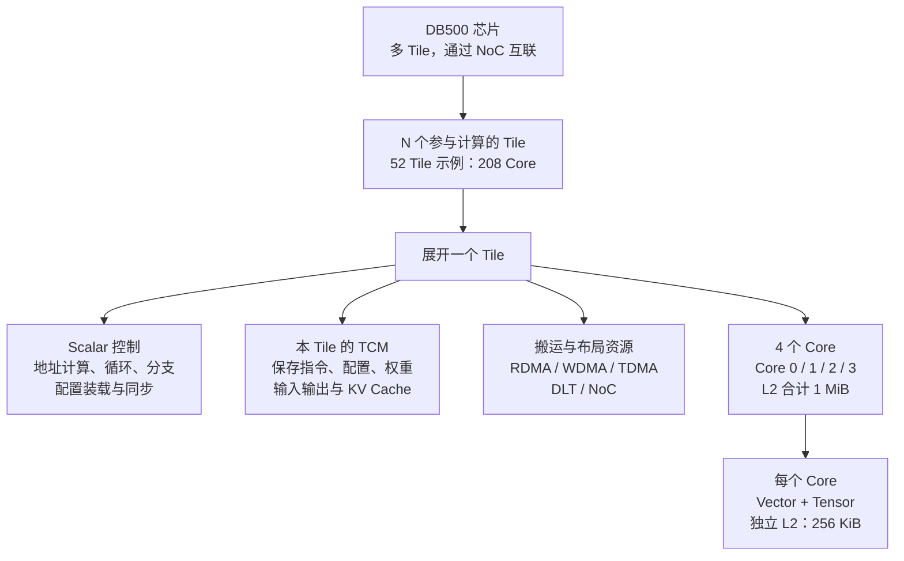
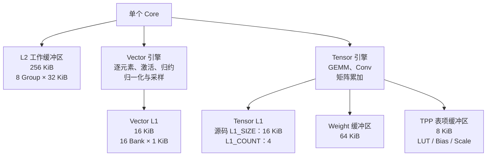
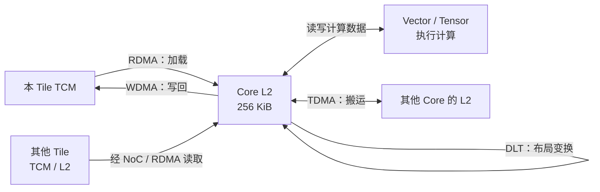

# DB500 芯片架构与硬件规格

本笔记根据本地 `DB500_OPS` 源码和 A510 Programming Guide 整理，用于理解算子如何映射到硬件。容量统一使用二进制单位：`1 KiB = 1024 B`，`1 MiB = 1024 KiB`。

> [!info] 阅读范围
> 当前源码确认的主要层级是 **芯片 → Tile → Core → 计算引擎与局部存储**。52 Tile 是默认编译配置示例；实际参与 Tile 数量及物理映射以目标 SKU 和运行配置为准。图中的逻辑层级不代表芯片的物理版图。

阅读导航：[[#1. 芯片、Tile 与 Core]] · [[#2. 单个 Core 的引擎与存储]] · [[#3. 各级硬件规格速查]] · [[#4. TCM 的逻辑区域]] · [[#5. 数据搬运与计算通路]] · [[#6. 同步机制与开发时的注意点]] · [[#7. 后续源码阅读入口]] · [[#8. 各模块的理论算力与带宽]]。

## 1. 芯片、Tile 与 Core

下图连线表示组成关系。



层级的含义：

| 层级 | 主要资源 | 学习时关注的内容 |
| --- | --- | --- |
| 芯片 | 多个 Tile，NoC 互联 | 数据如何分布到不同 Tile，以及跨 Tile 通信 |
| Tile | Scalar、4 Core、TCM、搬运与布局资源 | 控制流、Tile 内协作与任务调度 |
| Core | Vector、Tensor、Core 级 L2 及局部资源 | 分块大小、局部计算与缓冲区复用 |
| 引擎 | Vector、Tensor、RDMA、WDMA、TDMA、DLT | 一段算子计算分别由哪些引擎完成 |

容量可从底层逐级推算：

- 单 Core L2：`256 KiB`。
- 单 Tile L2 合计：`4 × 256 KiB = 1 MiB`。
- N 个参与 Tile：`4N` 个 Core，L2 合计 `N MiB`。
- 52 Tile 示例：`208 Core`，L2 合计 `52 MiB`。

这些 L2 分布在各个 Core 中；合计容量不能直接当作一个统一的共享缓冲池使用。

依据：[硬件执行模型](/Users/ylzzz/code/work/agic/DB500_OPS/docs/a510-programming-guide.md:16)、[默认 Tile 配置的读取](/Users/ylzzz/code/work/agic/DB500_OPS/AGOPS/codegen/container/param_container.py:33)。

## 2. 单个 Core 的引擎与存储

下图连线表示资源归属或关联。Tensor L1 仅标注源码定义，具体实例范围需结合目标硬件手册确认。



> [!note] Tensor L1 与 Weight 的容量解释
> `Tensor_L1` 定义了 `L1_SIZE=0x4000` 和 `L1_COUNT=4`；不要据此直接认定每 Core 拥有 64 KiB Tensor L1。Weight 定义了 `WEI_BUF_SIZE=64 KiB`、`WEI_CLU_SIZE=32 KiB` 和 `CLU_NUM=4`；逻辑 cluster 不能直接当作独立物理池相乘，使用缓冲区时以 `WEI_BUF_SIZE` 为容量依据。

依据：[L2 常量](/Users/ylzzz/code/work/agic/DB500_OPS/AGOPS/utility/hardware_info.py:4)、[Weight 与 TPP](/Users/ylzzz/code/work/agic/DB500_OPS/AGOPS/utility/hardware_info.py:19)、[Vector L1 与 Tensor L1](/Users/ylzzz/code/work/agic/DB500_OPS/AGOPS/utility/hardware_info.py:39)。

## 3. 各级硬件规格速查

| 资源 | 源码确认的规格 | 地址或用途 |
| --- | --- | --- |
| Tile | 4 Core；L2 合计 1 MiB | Scalar 协调控制流及引擎执行 |
| Core L2 | 256 KiB，8 Group，每 Group 32 KiB | Core 0 调试绝对基址 `0xf0400000`；Core 间地址步长 `0x40000` |
| Vector L1 | 16 KiB，16 Bank，每 Bank 1 KiB | 调试绝对基址 `0xf0030000` |
| Tensor L1 | `L1_SIZE=16 KiB`，`L1_COUNT=4` | 实例范围和物理组织需查目标手册 |
| Weight | 缓冲区容量 64 KiB | 调试绝对基址 `0xf0100000` |
| TPP | 8 KiB | 调试绝对基址 `0xf01e0000`；保存 LUT、bias、scale 等表项 |
| TCM | 与 Tile 关联；物理容量依目标设备确认 | 指令、配置、离线权重、在线数据、KV Cache、日志等 |
| 本地 Barrier | 16 个 ID，范围 0–15 | 协调不同引擎间的数据依赖与执行次序 |

Core n 的 L2 调试绝对基址为：

```text
0xf0400000 + n × 0x40000，n = 0、1、2、3
```

L2 Group 的相对起始地址分别为：

```text
Group 0：0x00000    Group 1：0x08000
Group 2：0x10000    Group 3：0x18000
Group 4：0x20000    Group 5：0x28000
Group 6：0x30000    Group 7：0x38000
```

> [!info] 地址语义
> 上表中的绝对地址用于设备 dump / 调试视角。配置中的相对地址、引擎单位地址、TCM 区域偏移与这些绝对地址具有不同含义；跨 Core、跨 Tile 时还需结合 `core_map`、`tile_map` 及 NoC 路由。

依据：[硬件地址与容量](/Users/ylzzz/code/work/agic/DB500_OPS/docs/a510-programming-guide.md:31)。

## 4. TCM 的逻辑区域

TCM 与 Tile 关联，跨 Tile 访问需要相应 NoC 配置和同步。下面七项是软件区域划分，各区实际起始地址和容量由运行环境决定。

| 区域 | TCMId | TCMRegion | SYSREG 偏移 | 主要用途 |
| --- | ---: | ---: | --- | --- |
| Inst | 0 | — | `0x14` | 指令 |
| Config | 1 | — | `0x18` | 引擎配置 |
| Offline | 2 | 0 | `0x1c` | 离线权重与常量 |
| Online | 3 | 1 | `0x20` | 在线输入输出 |
| KVcache | 4 | 2 | `0x64` | Attention KV Cache |
| Custom | 5 | 3 | `0x68` | 自定义数据 |
| Evtlog | 6 | — | `0x24` | 事件日志 |

`SYSREG 偏移` 表示读取相应区域偏移信息的寄存器位置；它既不是该 TCM 区域的大小，也不是该区域的实际内存基址。

依据：[TCM 区域说明](/Users/ylzzz/code/work/agic/DB500_OPS/docs/a510-programming-guide.md:51)。

## 5. 数据搬运与计算通路

下面是典型的数据流逻辑关系，具体支持的地址组合、类型和模式需以对应 Kernel 的检查为准。



| 引擎 / 通路 | 主要职责 | 源码中的典型单位 |
| --- | --- | --- |
| RDMA | 从本地 / 远端 TCM 或远端 L2 加载到 L2、Weight、表项等目标 | DMA：128 B |
| WDMA | 将 L2 结果写回 TCM | DMA：128 B |
| TDMA | 包括 Core 间 L2 搬运、TCM 间搬运等 | DMA：128 B |
| DLT | 布局变换、重排等 | 地址单位：16 B |
| Vector | 向量计算 | 工作区配置单位：32 B |
| Tensor | 矩阵与卷积计算 | 地址单位：32 B |
| NoC | 跨 Tile 传输，访问远端 TCM / L2 等资源 | 结合具体路由与 Kernel 配置 |

128 B 是 DMA 的典型传输与地址粒度；具体模式存在例外，例如 RDMA `fill_param` 使用更小的长度单位，应继续查看 Kernel 实现。

阅读算子的典型顺序是：**输入位于哪一段 TCM → 由哪个 DMA 搬到哪一块局部缓冲区 → 用哪个引擎计算 → 何时写回，以及何时可以复用缓冲区**。

依据：[地址单位](/Users/ylzzz/code/work/agic/DB500_OPS/docs/a510-programming-guide.md:71)、[RDMA Kernel](/Users/ylzzz/code/work/agic/DB500_OPS/AGOPS/operator_compiler/kernel/dma/kl_rdma.py)、[TDMA Kernel](/Users/ylzzz/code/work/agic/DB500_OPS/AGOPS/operator_compiler/kernel/dma/kl_tdma.py)。

## 6. 同步机制与开发时的注意点

- 本地 Barrier ID 范围为 `0–15`，生成指令时转换为位掩码。
- `sbarrier` 表示完成后发布同步信号；`wbarrier` 表示启动前等待同步信号。
- 跨 Tile 同步需使用独立的 inter-barrier / semaphore 机制。
- 计算、搬运、布局变换可能形成流水；只有在最后一个消费者完成之后才能复用对应缓冲区。
- `SHType` 中存在某个 dtype，不代表所有引擎、所有算子都支持该 dtype，需检查具体 Task / Kernel。

> [!todo] 尚待目标 SKU 手册确认的规格
> Die 数量、主频、峰值算力、计算阵列规模、TCM 物理容量、外部内存容量及带宽、功耗。`compiler_config.json` 中的 `tcm_size=0x80000000`（2 GiB）是编译环境配置，不能据此确定实卡容量。

旧文档 `hardware_abstraction.md` 中的固定 52 Tile、Tensor 没有 L1 等表述与当前源码存在出入；核对时优先查看源码和目标硬件手册。

依据：[同步与生命周期](/Users/ylzzz/code/work/agic/DB500_OPS/docs/a510-programming-guide.md:170)、[编译环境参数的使用边界](/Users/ylzzz/code/work/agic/DB500_OPS/docs/a510-programming-guide.md:151)。

## 7. 后续源码阅读入口

按下面顺序对照本笔记阅读：

1. [hardware_info.py](/Users/ylzzz/code/work/agic/DB500_OPS/AGOPS/utility/hardware_info.py)：先记住 Core、L2、L1、Weight、TPP 和 TCM 的基础定义。
2. [compiler_config.json](/Users/ylzzz/code/work/agic/DB500_OPS/AGOPS/config/compiler_config.json) 与 [param_container.py](/Users/ylzzz/code/work/agic/DB500_OPS/AGOPS/codegen/container/param_container.py)：查看 Tile 数量、参与集合和编译环境参数如何生效。
3. [sh_type.py](/Users/ylzzz/code/work/agic/DB500_OPS/AGOPS/utility/task/sh/sh_type.py)：查看 `BufferType`、dtype 等软件描述。
4. [sh_kernel.py](/Users/ylzzz/code/work/agic/DB500_OPS/AGOPS/operator_compiler/base/sh_kernel.py)：查看 Barrier、地址单位与 Core 映射。
5. [kl_rdma.py](/Users/ylzzz/code/work/agic/DB500_OPS/AGOPS/operator_compiler/kernel/dma/kl_rdma.py)、[kl_wdma.py](/Users/ylzzz/code/work/agic/DB500_OPS/AGOPS/operator_compiler/kernel/dma/kl_wdma.py)、[kl_tdma.py](/Users/ylzzz/code/work/agic/DB500_OPS/AGOPS/operator_compiler/kernel/dma/kl_tdma.py)：对照数据通路图追踪实际配置。
6. [A510 Programming Guide](/Users/ylzzz/code/work/agic/DB500_OPS/docs/a510-programming-guide.md)：串联硬件模型、布局、编译链和测试方式。

学习记录：

- [ ] 能从 Tile 数量推算 Core 数量与 L2 合计容量。
- [ ] 能区分 TCM、L2、Vector L1、Tensor L1、Weight 和 TPP。
- [ ] 能解释 RDMA / WDMA / TDMA / DLT / NoC 各自负责什么。
- [ ] 选一个简单算子，标出加载、计算、写回及 Barrier 依赖。
- [ ] 阅读目标 SKU 手册，补充本笔记中的待确认规格。

## 8. 各模块的理论算力与带宽

### 8.1 已找到的性能模型及使用条件

`benchmarks/core/types.py` 中的 `HardwarePerformanceProfile` 定义了以下默认参数：

| 参数 | 默认值 | 含义 |
| --- | ---: | --- |
| `cores_per_tile` | 4 | 每 Tile 的 Core 数 |
| `tensor_macs_per_cycle_per_core` | 1024 | 每 Core 的 Tensor 每周期乘加次数 |
| `vector_flops_per_cycle_per_core` | 16 | 每 Core 的 Vector 每周期浮点运算次数 |
| `tcm_gb_s_per_stack_per_tile` | 64 | 每 Tile、每 TCM stack 的模型带宽，单位 GB/s |
| `default_tcm_stacks` | 4 | 模型默认采用的 stack 数 |

> [!info] 本节数字的口径
> 本节给出 **benchmark 默认模型下的理论估算**。时钟采用模拟器验证记录中的 `NPU_CLOCK=1000 MHz`，即 1 GHz；它不能证明目标实卡的实际主频。该性能模型没有按 FP16、BF16、FP32、INT8 或稀疏模式细分，因此也不能将这些估算直接作为某种精度的官方峰值规格。

来源：[默认性能模型](/Users/ylzzz/code/work/agic/DB500_OPS/benchmarks/core/types.py:79)、[模拟器验证环境](/Users/ylzzz/code/work/agic/DB500_OPS/benchmarks/VALIDATION.md:12)。

### 8.2 从每周期运算量换算算力

这里按 benchmark 的口径计算：**1 次 MAC = 1 次乘法 + 1 次加法 = 2 FLOPs**。Vector 的 `16` 已经是 FLOPs/周期，不再乘 2。

```text
单 Core Tensor：1024 MAC/周期 × 2 FLOP/MAC × 10^9 周期/秒
              = 2.048 × 10^12 FLOP/s
              = 2.048 TFLOP/s

单 Core Vector：16 FLOP/周期 × 10^9 周期/秒
              = 16 × 10^9 FLOP/s
              = 16 GFLOP/s = 0.016 TFLOP/s
```

以下各项都沿用同一默认模型，并假设对应 Core 全部启用、时钟为 1 GHz：

| 层级 | Core 数 | Tensor 理论算力 | Vector 理论算力 |
| --- | ---: | ---: | ---: |
| 单 Core | 1 | 2.048 TFLOP/s | 16 GFLOP/s |
| 单 Tile | 4 | 8.192 TFLOP/s | 64 GFLOP/s |
| 16 个参与 Tile | 64 | 131.072 TFLOP/s | 1.024 TFLOP/s |
| 48 个参与 Tile | 192 | 393.216 TFLOP/s | 3.072 TFLOP/s |
| 52 个参与 Tile | 208 | 425.984 TFLOP/s | 3.328 TFLOP/s |

更一般地，设参与 Tile 数为 `N`、NPU 时钟为 `f_GHz`，则模型的聚合理论值为：

```text
Tensor：N × 4 × 1024 × 2 × f_GHz × 10^9 / 10^12
       = 8.192 × N × f_GHz TFLOP/s

Vector：N × 4 × 16 × f_GHz × 10^9 / 10^12
       = 0.064 × N × f_GHz TFLOP/s
```

Tensor 和 Vector 分别服务矩阵类、向量类计算。评估某个算子时，需要按实际使用的引擎和流水线分析，不能把两列相加后当成该算子的可达吞吐。上述模型也没有给出 exp、sqrt、除法、归约等每种指令的独立吞吐。

来源：[理论算力计算实现](/Users/ylzzz/code/work/agic/DB500_OPS/benchmarks/core/theoretical.py:90)、[MAC/FMA 计数约定](/Users/ylzzz/code/work/agic/DB500_OPS/benchmarks/PERFORMANCE_ANALYSIS_STANDARD.md:40)。

### 8.3 搬运、控制与存储模块如何衡量

| 模块 | 主要性能指标 | 当前能给出的结论 |
| --- | --- | --- |
| Tensor | MAC/周期、对应精度的 FLOP/s 或 OP/s | 默认模型为 1024 MAC/周期/Core；特定精度的实卡峰值待确认 |
| Vector | 对应指令的 FLOP/周期、元素/周期 | 默认模型为 16 FLOP/周期/Core；不同指令的吞吐需另查 |
| Scalar | IPC、控制与配置开销、指令延迟 | 当前未找到可确认的峰值 IPC/指令吞吐 |
| RDMA / WDMA / TDMA | GB/s、搬运延迟、并发能力 | 当前没有确认到各引擎独立的峰值带宽 |
| DLT | 元素/周期、GB/s、布局变换延迟 | 16 B 是地址单位，不能据此认为每周期处理 16 B |
| NoC | 链路与聚合带宽、延迟、拓扑竞争 | 当前没有确认到独立的硬件峰值带宽 |
| L1 / L2 / Weight / TPP | 容量、访问带宽与延迟 | 前文容量已核对；访问吞吐还需手册或测试确认 |
| TCM | 容量、带宽与访问延迟 | 有 benchmark 的默认带宽模型，见下文 |

DMA 的 128 B 同样是地址/传输的典型单位，不等于已经确认了 128 B/周期的搬运能力。

### 8.4 TCM 带宽的模型估算

沿用 `default_tcm_stacks=4` 和 `64 GB/s/stack/Tile` 的默认模型：

```text
单 Tile TCM 带宽：4 × 64 = 256 GB/s
N Tile 聚合带宽：N × 256 GB/s
52 Tile 聚合带宽：52 × 256 / 1000 = 13.312 TB/s
```

这里使用十进制带宽单位：`1 GB/s = 10^9 B/s`，`1 TB/s = 10^12 B/s`。这是模型的跨 Tile 聚合值；实际通路还受 DMA、NoC、访问模式和竞争等因素影响，不能直接当成任意一次 DMA 拷贝的吞吐。

来源：[TCM 理论带宽计算](/Users/ylzzz/code/work/agic/DB500_OPS/benchmarks/core/theoretical.py:76)。

### 8.5 理论算力与算子实测吞吐

以 GEMM 为例，按有效工作量统计：

```text
运算量：FLOPs = 2 × M × N × K
耗时：t_seconds = cycles / (f_MHz × 10^6)
有效吞吐：FLOPs / t_seconds / 10^12，单位 TFLOP/s
```

这是算子的有效吞吐，受到加载、写回、同步、尾块、分块和计算利用率影响。当前 benchmark 的主 cycles 取 Tile 0，缺失时取首个可用 Tile，尚不等于多 Tile 全局关键路径；比较聚合理论值和实测值时要同时核对测量范围。

来源：[GEMM 工作量定义](/Users/ylzzz/code/work/agic/DB500_OPS/benchmarks/bench_gemm.py:121)、[吞吐计算](/Users/ylzzz/code/work/agic/DB500_OPS/benchmarks/core/metrics.py:48)、[报告口径](/Users/ylzzz/code/work/agic/DB500_OPS/benchmarks/README.md:184)。
